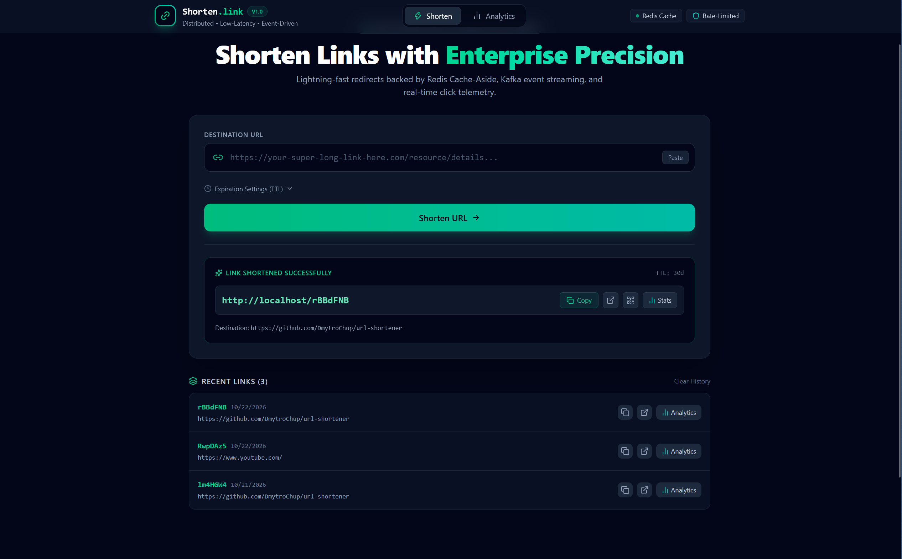

# Distributed URL Shortener & Analytics Platform

[](https://github.com/DmytroChup/url-shortener/actions/workflows/ci.yml)


A distributed URL shortening and clickstream analytics platform built with Spring Boot, Apache Kafka, Redis, PostgreSQL, and a modern React 19 SPA.

The service separates the latency-critical redirect path from event processing using the **Transactional Outbox Pattern**, and incorporates **Resilience4j circuit breaking**, **idempotent Kafka consumption**, and **distributed tracing via OpenZipkin**.

---

## Web Dashboard Preview



*Developer-first SPA interface featuring dark OLED aesthetics, QR code generation, configurable TTL link retention, and real-time Kafka click telemetry charts.*

---

## Architecture


The platform is decomposed into four primary parts:

* **Frontend & Edge Reverse Proxy (`:80`)**: Nginx reverse proxy serving the compiled React 19 SPA. Serves as the single unified public entry point, proxies API calls and short link redirects to the API Gateway, caches static assets, and strips client-spoofed `X-Forwarded-For` headers.
* **API Gateway (`:8080`)**: Built on Spring Cloud Gateway (WebFlux / Netty). Manages path routing, Redis Token Bucket rate limiting, and circuit breaking for downstream analytics requests.
* **URL Service (`:8081`)**: Manages Base62 link generation, Redis cache-aside lookups, and transactional persistence of click events into an Outbox table.
* **Analytics Service (`:8082`)**: Consumes click events from Kafka, guarantees idempotent processing via unique event identifiers, enriches clicks with GeoIP and User-Agent heuristics (device, OS, browser), routes poison pills to a Dead Letter Topic, and exposes aggregated statistics.

---

## Distributed Systems & Resilience Patterns

### 1. Unified Edge Entrypoint & Anti-Spoofing
All external traffic terminates at the Nginx edge proxy on port `80`. Nginx overrides incoming `X-Forwarded-For` headers with `$remote_addr` (socket IP), neutralizing client IP spoofing before requests reach the internal Spring Cloud Gateway and rate limiters.

### 2. Transactional Outbox (Dual-Write Prevention)
Writing to PostgreSQL and publishing to Kafka within separate calls introduces potential state divergence if the network fails midway.
On every redirect, `UrlClickEvent` is stored inside the local `outbox_events` table within the same database transaction. An asynchronous worker polls unpublished events, pushes them to the `url-clicks` Kafka topic, and marks them processed upon broker acknowledgement.

### 3. Idempotent Consumer
Kafka provides at-least-once delivery semantics, meaning network retries or consumer group rebalances can cause duplicated event delivery.
The consumer tracks incoming `eventId` (UUID) values within a `processed_events` table. Duplicate events are acknowledged and discarded without updating click counts.

### 4. Dead Letter Topic (DLT / Poison Pill Isolation)
Unparseable payloads or unexpected deserialization errors can block partition offsets and halt consumer progress.
A custom `DefaultErrorHandler` with exponential backoff intercepts failing records and redirects unrecoverable events to `url-clicks.DLT`, allowing the main consumer loop to proceed uninterrupted.

### 5. Circuit Breaker & Fallback
To prevent cascading service degradation, the API Gateway protects analytics routes with **Resilience4j**. If downstream failure rates exceed 50%, the gateway opens the circuit and immediately responds with an **RFC 7807 Problem Detail (503 Service Unavailable)** fallback without blocking worker threads.

### 6. Cache Penetration Protection
Direct database queries for non-existent short codes can exhaust database connections under high traffic or scanning attacks.
When a short code is not found, a negative cache entry (`__NOT_FOUND__`) is written to Redis with a short 5-minute TTL, absorbing subsequent misses directly in memory.

### 7. Distributed Tracing
All HTTP requests, reactive Gateway filters, and asynchronous Kafka messages propagate W3C/B3 trace headers instrumented via **Micrometer Tracing** and **Brave**, with visualization in **OpenZipkin**.

---

## Repository Layout

```
url-shortener/
├── frontend/            # React 19 SPA, Tailwind CSS v4, Lucide icons, Recharts
├── api-gateway/         # Reactive gateway, rate limiting, circuit breaker fallback
├── contracts/           # Shared domain events (UrlClickEvent) and DTOs
├── url-service/         # Base62 shortening, Redis cache-aside, Outbox publisher
├── analytics-service/   # Kafka consumer, idempotent processing, DLT routing
├── docker/              # Multi-database init scripts
├── load-tests/          # k6 load testing benchmark scripts
├── .github/workflows/   # CI/CD pipeline (Testcontainers + Docker builds)
├── compose.yaml         # Production perimeter (port 80 only)
└── compose.dev.yaml     # Local dev overlay (loopback ports for DBs, Swagger, Zipkin)
```

---

## Quickstart

### Prerequisites
* Docker & Docker Compose

### 1. Production Mode (Hardened Perimeter)
Only Nginx (port `80`) is exposed. All backend services and databases remain private inside the Docker network:
```bash
docker compose up --build -d
```
Access the application at `http://localhost`.

### 2. Development Mode (With Debugging Ports)
Uses `compose.dev.yaml` to bind debugging ports strictly to `127.0.0.1` (loopback):
```bash
docker compose -f compose.yaml -f compose.dev.yaml up --build -d
```

### Endpoints & Infrastructure

| Service               | Public Port (Prod) | Dev Port (Loopback) | Description                             | Docs / UI                               |
|-----------------------|--------------------|---------------------|-----------------------------------------|-----------------------------------------|
| **Frontend & Edge**   | `80`               | `80`                | React SPA & Nginx Edge Reverse Proxy    | `http://localhost/`                     |
| **API Gateway**       | *Internal*         | `127.0.0.1:8080`    | Internal Gateway & Token Bucket Limiter | Root routing                            |
| **URL Service**       | *Internal*         | `127.0.0.1:8081`    | Base62 shortening & Outbox publisher    | `http://localhost:8081/swagger-ui.html` |
| **Analytics Service** | *Internal*         | `127.0.0.1:8082`    | Clickstream consumer & reporting        | `http://localhost:8082/swagger-ui.html` |
| **Zipkin UI**         | *Internal*         | `127.0.0.1:9411`    | Distributed tracing dashboard           | `http://localhost:9411/zipkin/`         |
| **PostgreSQL**        | *Internal*         | `127.0.0.1:5444`    | Databases: `urls_db`, `analytics_db`    | Mapped to internal `5432`               |
| **Apache Kafka**      | *Internal*         | `127.0.0.1:9094`    | KRaft single-node broker                | Port `9092` internal                    |
| **Redis**             | *Internal*         | `127.0.0.1:6379`    | Cache-aside & rate limiter storage      | Standalone                              |

---

## API Verification (cURL)

Requests should be sent directly to the single entry point (`http://localhost`):

### 1. Shorten a URL
```bash
curl -X POST http://localhost/api/v1/urls/shorten \
  -H "Content-Type: application/json" \
  -d '{"url": "https://spring.io", "ttlDays": 30}'
```
Response:
```
"aB7xK9q"
```

### 2. Follow Redirect (HTTP 302)
```bash
curl -i http://localhost/aB7xK9q
```
Response:
```http
HTTP/1.1 302 Found
Location: https://spring.io
```

### 3. Check Analytics
```bash
curl http://localhost/api/v1/analytics/aB7xK9q
```
Response:
```json
{
  "shortCode": "aB7xK9q",
  "totalClicks": 1,
  "topCountries": {
    "US": 1
  },
  "devices": {
    "DESKTOP": 1
  },
  "topBrowsers": {
    "Chrome": 1
  },
  "topOperatingSystems": {
    "Windows": 1
  }
}
```

---

## Load Testing & Benchmarks

The redirect engine was benchmarked using **Grafana k6** running inside the Docker network against the core service under a 50-second ramping profile with zero-redirect tracking:

| Metric               | Result           | Notes                                                        |
|----------------------|------------------|--------------------------------------------------------------|
| **Throughput (RPS)** | **3,891+ req/s** | Peak sustained redirect rate                                 |
| **Total Requests**   | **220,821**      | Total operations completed during test run                   |
| **Success Rate**     | **100.00%**      | 220,811 / 220,811 successful HTTP 302 redirects (0 failures) |
| **P50 Latency**      | **13.4 ms**      | Median response time                                         |
| **P90 Latency**      | **22.2 ms**      | 90th percentile latency                                      |
| **P95 Latency**      | **28.7 ms**      | 95th percentile latency                                      |
| **P99 Latency**      | **40.8 ms**      | 99th percentile (includes PostgreSQL Outbox persistence)     |

```powershell
# Run the benchmark
cat load-tests/redirect-benchmark.js | docker run --rm -i --network url-shortener_default -e TARGET_URL=http://url-service:8081 grafana/k6 run -
```

---

## Testing & CI/CD

* **Unit Testing**: Business logic isolated with JUnit 5 and Mockito.
* **Integration Testing**: Multi-module suites tested against real PostgreSQL, Redis, and Kafka containers via **Testcontainers**.
* **CI Pipeline**: Automated build and verification on **GitHub Actions** (`.github/workflows/ci.yml`) using Java 25, Gradle build cache, and parallel Dockerfile verification.

```bash
# Run local test suite
./gradlew test
```

---

## License
This project is open-source and available under the [MIT License](LICENSE).
