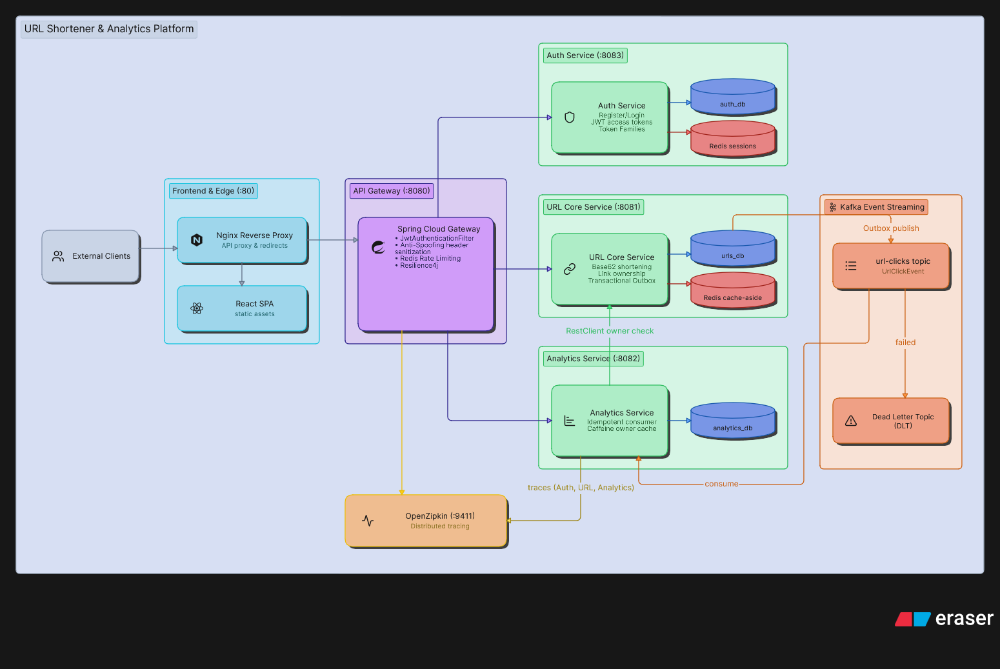

# Distributed URL Shortener & Analytics Platform

[](https://github.com/DmytroChup/url-shortener/actions/workflows/ci.yml)


A distributed URL shortening and clickstream analytics service built with Spring Boot, Apache Kafka, Redis, and PostgreSQL. 

The service separates the latency-critical redirect path from event processing using the **Transactional Outbox Pattern**, and incorporates **Resilience4j circuit breaking**, **idempotent consumption**, and **distributed tracing via OpenZipkin**.

---

## Architecture



The platform is decomposed into three primary services:

* **API Gateway (`:8080`)**: Built on Spring Cloud Gateway (Netty). Handles path routing, Redis Token Bucket rate limiting, and circuit breaking for downstream analytics requests.
* **URL Service (`:8081`)**: Manages Base62 link generation, Redis cache-aside lookups, and transactional persistence of click events into an Outbox table.
* **Analytics Service (`:8082`)**: Consumes click events from Kafka, guarantees idempotent processing via unique event identifiers, enriches clicks with GeoIP and User-Agent heuristics (device, OS, browser), routes poison pills to a Dead Letter Topic, and exposes Top-10 aggregated statistics.

---

## Distributed Systems & Resilience Patterns

### 1. Transactional Outbox (Dual-Write Prevention)
Writing to PostgreSQL and publishing to Kafka within separate calls introduces potential state divergence if the network fails midway.  
On every redirect, `UrlClickEvent` is stored inside the local `outbox_events` table within the same database transaction. An asynchronous worker polls unpublished events, pushes them to the `url-clicks` Kafka topic, and marks them processed upon broker acknowledgement.

### 2. Idempotent Consumer
Kafka provides at-least-once delivery semantics, meaning network retries or consumer group rebalances can cause duplicated event delivery.  
The consumer tracks incoming `eventId` (UUID) values within a `processed_events` table. Duplicate events are acknowledged and discarded without updating click counts.

### 3. Dead Letter Topic (DLT / Poison Pill Isolation)
Unparseable payloads or unexpected deserialization errors can block partition offsets and halt consumer progress.  
A custom `DefaultErrorHandler` with exponential backoff intercepts failing records and redirects unrecoverable events to `url-clicks.DLT`, allowing the main consumer loop to proceed uninterrupted.

### 4. Circuit Breaker & Fallback
To prevent cascading service degradation, the API Gateway protects analytics routes with **Resilience4j**. If downstream failure rates exceed 50%, the gateway opens the circuit and immediately responds with an **RFC 7807 Problem Detail (503 Service Unavailable)** fallback without blocking worker threads.

### 5. Cache Penetration Protection
Direct database queries for non-existent short codes can exhaust database connections under high traffic or scanning attacks.  
When a short code is not found, a negative cache entry (`__NOT_FOUND__`) is written to Redis with a short 5-minute TTL, absorbing subsequent misses directly in memory.

### 6. Distributed Tracing
All HTTP requests, reactive Gateway filters, and asynchronous Kafka messages propagate W3C/B3 trace headers instrumented via **Micrometer Tracing** and **Brave**, with visualization in **OpenZipkin**.

---

## Repository Layout

```
url-shortener/
├── api-gateway/         # Reactive gateway, rate limiting, circuit breaker fallback
├── contracts/           # Shared domain events (UrlClickEvent) and DTOs
├── url-service/         # Base62 shortening, Redis cache-aside, Outbox publisher
├── analytics-service/   # Kafka consumer, idempotent processing, DLT routing
├── docker/              # Multi-database init scripts
├── load-tests/          # k6 load testing benchmark scripts
├── .github/workflows/   # CI/CD pipeline (Testcontainers + Docker builds)
└── compose.yaml         # Multi-container orchestration
```

---

## Quickstart

### Prerequisites
* Docker & Docker Compose

```bash
# Clone the repository
git clone https://github.com/DmytroChup/url-shortener.git
cd url-shortener

# Start the entire ecosystem
docker compose up --build -d
```

### Endpoints & Infrastructure

| Service               | Port         | Description                            | Docs                                    |
|-----------------------|--------------|----------------------------------------|-----------------------------------------|
| **API Gateway**       | `8080`       | Public reverse proxy & rate limiter    | Root routing                            |
| **URL Service**       | `8081`       | Core shortening & redirect service     | `http://localhost:8081/swagger-ui.html` |
| **Analytics Service** | `8082`       | Clickstream consumer & reporting       | `http://localhost:8082/swagger-ui.html` |
| **Zipkin UI**         | `9411`       | Distributed tracing dashboard          | `http://localhost:9411/zipkin/`         |
| **PostgreSQL**        | `5444`       | Databases: `urls_db`, `analytics_db`   | Mapped to internal `5432`               |
| **Apache Kafka**      | `9092, 9094` | KRaft broker (internal & external)     | Port `9092` internal                    |
| **Redis**             | `6379`       | In-memory cache & rate limiter storage | Standalone                              |

---

## API Verification (cURL)

Requests should be sent directly to the **API Gateway** (`http://localhost:8080`):

### 1. Shorten a URL
```bash
curl -X POST http://localhost:8080/api/v1/urls/shorten \
  -H "Content-Type: application/json" \
  -d '{"url": "https://spring.io", "ttlDays": 30}'
```
Response:
```
"aB7xK9q"
```

### 2. Follow Redirect (HTTP 302)
```bash
curl -i http://localhost:8080/aB7xK9q
```
Response:
```http
HTTP/1.1 302 Found
Location: https://spring.io
```

### 3. Check Analytics
```bash
curl http://localhost:8080/api/v1/analytics/aB7xK9q
```
Response:
```json
{
  "shortCode": "aB7xK9q",
  "totalClicks": 1,
  "topCountries": {
    "US": 1
  },
  "devices": {
    "DESKTOP": 1
  },
  "topBrowsers": {
    "Chrome": 1
  },
  "topOperatingSystems": {
    "Windows": 1
  }
}
```

### 4. Test Circuit Breaker Fallback
Stop the analytics container to simulate a downstream outage:
```bash
docker compose stop analytics-service
curl -i http://localhost:8080/api/v1/analytics/aB7xK9q
```
Fallback Response:
```http
HTTP/1.1 503 Service Unavailable
Content-Type: application/problem+json

{
  "type": "urn:problem-type:service-unavailable",
  "title": "Service Unavailable",
  "status": 503,
  "detail": "Analytics service is temporarily unavailable. Please try again later."
}
```

---

## Load Testing & Benchmarks

The redirect engine was benchmarked using **Grafana k6** running inside the Docker network against the core service under a 50-second ramping profile with zero-redirect tracking:

| Metric               | Result           | Notes                                                        |
|----------------------|------------------|--------------------------------------------------------------|
| **Throughput (RPS)** | **3,891+ req/s** | Peak sustained redirect rate                                 |
| **Total Requests**   | **220,821**      | Total operations completed during test run                   |
| **Success Rate**     | **100.00%**      | 220,811 / 220,811 successful HTTP 302 redirects (0 failures) |
| **P50 Latency**      | **13.4 ms**      | Median response time                                         |
| **P90 Latency**      | **22.2 ms**      | 90th percentile latency                                      |
| **P95 Latency**      | **28.7 ms**      | 95th percentile latency                                      |
| **P99 Latency**      | **40.8 ms**      | 99th percentile (includes PostgreSQL Outbox persistence)     |

```powershell
# Run the benchmark
cat load-tests/redirect-benchmark.js | docker run --rm -i --network url-shortener_default -e TARGET_URL=http://url-service:8081 grafana/k6 run -
```

---

## Testing & CI/CD

* **Unit Testing**: Business logic isolated with JUnit 5 and Mockito.
* **Integration Testing**: Multi-module suites tested against real PostgreSQL, Redis, and Kafka containers via **Testcontainers**.
* **CI Pipeline**: Automated build and verification on **GitHub Actions** (`.github/workflows/ci.yml`) using Java 25, Gradle build cache, and parallel Dockerfile verification.

```bash
# Run local test suite
./gradlew test
```

---

## License
This project is open-source and available under the [MIT License](LICENSE).
